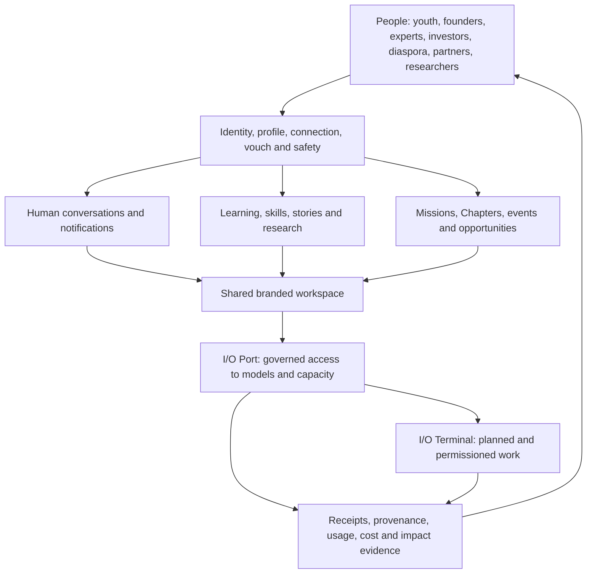

# Indus Orbit living system record

## Current source finalization — 22 October 2026

[The current whole-product report](PRODUCTION_STATUS_2026-10-22.md) and [chat candidate](conversation-system/CHAT_RELEASE_CANDIDATE.md) supersede the earlier implementation-plan states below. Private messages, the shared premium interface and community/event discussions are implemented; local member verification passes 285 units, admin 35, and final managed CI passes **133-migration replay, 40 SQL files / 1,371 assertions, exact types and schema lint**, including the safety-retry correction. Exact source/hash evidence is under `../release-evidence/chat-2026-10-22/`.

Full public production remains **Partial**. The 22 October read-only check confirms the correct healthy hosted project still has 116 migrations/ten functions; **15 reviewed forward migrations and seven new functions** require staged delivery. Member changes are published in [draft PR #2](https://github.com/helloimakeimpact/indus-orbit-india/pull/2); they are not yet promoted to the Netlify production branch. [Owner actions](PRODUCTION_OWNER_ACTIONS.md) separate setup/sign-off from engineering's remaining integration/recovery obligations. The dated checkpoints below preserve their original evidence.

## Lightweight chat scope — 20 October 2026

[The current conversation plan](conversation-system/LIGHTWEIGHT_CHAT_FINALIZATION_PLAN.md) records the owner's approved private-message/event/community-group scope, three independent audits, two repaired merge regressions and the remaining source/release gates. Overall chat remains **Partial**; E2EE is planned separately. The source/CI checkpoint below precedes this new work. Read the chat plan alongside the whole-product status and owner actions.

## Current consolidated status — 20 October 2026

[The detailed whole-product report](PRODUCTION_STATUS_2026-10-20.md) consolidates completed brand/UI, continuity, events, communication, education safety, privacy, admin and I/O foundations. Both source trees match published GitHub and their recorded CI passes. Today’s hosted read remains healthy at 116 migrations/ten functions; twelve reviewed forward migrations and seven functions still need staged delivery. Full production remains **Partial**. The older dated checkpoints below retain their original evidence.

## Source publication — 19 October

Completed source is committed/published; member Quality, Database quality and Admin quality all pass. [Exact publication](SOURCE_PUBLICATION_2026-10-19.md) records 130-migration managed replay, 1,237 SQL assertions, 271 units and 49 browser journeys. [Current production status](PRODUCTION_STATUS_2026-10-19.md) remains Partial until hosted service/operator/recovery acceptance.

## Final source checks — 19 October

The final local gates pass 236 member units, 35 admin units and 49 browser journeys; dependency audits are clean after the TanStack security patch. [The current production report](PRODUCTION_STATUS_2026-10-19.md) and [exact evidence](../release-evidence/finalization-2026-10-18/verification.md) distinguish completed source from hosted delivery. Source publication/CI is recorded separately after verification.

## Current handoff — 18 October 2026

The owner delegated retention choices on 15 October with **“use best practice”**. Earlier requests below to supply different rules are superseded. Read [the current status](PRODUCTION_STATUS_2026-10-19.md), [privacy policy](PRIVACY_EXECUTION_POLICY.md) and [delivery runbook](PRIVACY_EXECUTION_RUNBOOK.md). Bounded privacy source is locally Verified; full public production remains Partial. Twelve forward migrations, seven new functions, genuine service/operator acceptance and recovery delivery remain. No new retention worksheet is required from the owner.

## Source publication and CI remediation — 13 October

Read [the publication record](SOURCE_PUBLICATION_2026-10-13.md) for the published member/admin commits, dependency remediation, approved-domain metadata and Storage fixture compatibility. Full public production remains Partial. Earlier dated entries retain their original checkpoint boundaries.

## Current source finalization — 13 October 2026

Read [the latest handoff](PRODUCTION_STATUS_2026-10-13.md). Chapter and separate admin event decisions now use inspected revisions; older commands cannot publish changed invitations. Withdrawal of a published invitation closes its lifecycle and queues guest cancellation mail. Source contains 128 migration files with ten reviewed forward releases awaiting hosted delivery. [Current verification](../release-evidence/finalization-2026-10-13/verification.md) separates local checks from hosted acceptance. The owner authorized commit/push of completed source; privacy export/deletion and physical cleanup still await their rules. Earlier dated checkpoints below retain their original evidence.

## Current handoff — 12 October 2026

Read [the production handoff](PRODUCTION_STATUS_2026-10-12.md): source hashes still match the 8 October database gates (127 files / 1,092 assertions), and the full app gate passes again with 214 units and build/budgets. Reliable event communications and education quarantine/immutable paths are Verified locally. Privacy execution awaits the owner's rules; nine reviewed migrations, four functions and genuine service/operating acceptance remain pending. No commit/push/deployment occurred.

## Continued finalization — 8 October 2026

Event communications and education quarantine/scanning are implemented in source. Read [the current report](PRODUCTION_STATUS_2026-10-08.md), [communications delivery](EVENT_COMMUNICATIONS_RUNBOOK.md) and [scanning delivery](EDUCATION_UPLOAD_SCANNING_RUNBOOK.md) for validation and release boundaries. Source contains 127 migrations, with nine reviewed forward releases pending. The owner will provide different retention rules; the proposed 90 days is not approved and deletion remains disabled. Earlier dated snapshots retain their original evidence.

## Current status — 7 October 2026

Overall: **Partial**. The latest read-only audit confirms the member checkout is one unpublished commit ahead of GitHub, with additional local event editing work. Admin source matches GitHub. The public Netlify site uses the healthy Indus Orbit backend, but seven forward migrations and both new event/form functions remain undelivered. OpenAI/DeepSeek routing remains disabled. Read [the current status report](PRODUCTION_STATUS_2026-10-07.md) and [dated observations](../release-evidence/status-2026-10-07/snapshot.json). The last full local test evidence remains 3 October; SQL hashes match that checkpoint. No product source, commit, push or hosted deployment changed in this audit.

> Resumed 3 October 2026: the owner confirmed indusorbit.com/Netlify, Resend, themselves as initial host/reviewer, and OpenAI/DeepSeek. See [verified connections and setup](LAUNCH_SETUP_AND_CONNECTIONS.md), [current status](PRODUCTION_STATUS_2026-10-03.md), and [resume evidence](../release-evidence/resume-2026-10-03/verification.md). The earlier stop checkpoint remains preserved in Git/evidence. New work stays local; hosted delivery remains pending.

## 3 October 2026 — native events and simpler verification

The owner requested a simpler replacement for hCaptcha and adaptation of Luma-like website elements. Current source uses Cloudflare Turnstile and native Community event discovery, invitation, free registration, host review, capacity/waitlists, scoped guest operations and revision-protected editing/rescheduling. Original branding/assets are retained. Read [PRODUCTION_STATUS_2026-10-03.md](PRODUCTION_STATUS_2026-10-03.md), [EVENTS_RELEASE_RUNBOOK.md](EVENTS_RELEASE_RUNBOOK.md) and [PUBLIC_FORMS_TURNSTILE_RUNBOOK.md](PUBLIC_FORMS_TURNSTILE_RUNBOOK.md) for the current implementation, local evidence and six remaining launch workstreams. Seven forward migrations and matching hosted delivery remain pending. See [event editing](EVENT_EDITING_RUNBOOK.md) for the resumed increment. Earlier dated hCaptcha/planned-event descriptions below are historical and superseded for these capabilities.

Status: canonical documentation hub, updated 7 October 2026 for the local/GitHub/hosted status audit. Earlier dated checkpoints below retain their original evidence boundaries.

This folder files the Indus Orbit product as a system: what it means, which code exists, what is operational, what remains, and how every subsystem fits the people-centred mission. Runtime source stays in its correct `src/` and `supabase/` locations; this record points to that source and distinguishes implementation from deployment.

## Current Community direction

Read `COMMUNITY_EVENTS_DIRECTION_AND_LUMA_ANALYSIS.md` for the 2 October events/community priority, Luma research, approved host/access decisions, source audit and E0–E6 execution gates. Core branding remains unchanged. Cloudflare Turnstile now replaces the earlier hCaptcha selection for public forms; operational setup and hosted enforcement remain pending.

## 2 October source delivery

The member and separate admin increments are committed and published. All three GitHub quality workflows passed; the live approved brand line and original artwork were checked on the public homepage and Brand page. Full public production remains Partial: hosted forward migrations, genuine personas, trusted workers/privacy, provider/payments, admin operations and recovery/design acceptance still need completion. See `../release-evidence/local-2026-10-02/publication.md` for exact commits and the current remaining-work record; older local-only notes retain their pre-publication date.

## How work is tracked

This directory is the single source of truth for delivery status. Do not create a second progress folder or treat an issue list, UI preview, migration file or local source tree as proof that a capability is live.

| Question                                                | Canonical file                                     |
| ------------------------------------------------------- | -------------------------------------------------- |
| What is done, partial, left or blocked?                 | `CODE_COMPLETION_REGISTER.md`                      |
| What phase comes next, and who owns it?                 | `PHASED_COMPLETION_PLAN_2026-09-08.md`             |
| What is the complete whole-product route to production? | `FINALIZATION_EXECUTION_PLAN.md`                   |
| What does the owner need to decide and supply?          | `PRODUCTION_OWNER_ACTIONS.md`                      |
| What is the Indus Orbit UI philosophy and design work?  | `DESIGN_PHILOSOPHY_AND_UI_PLAN.md`                 |
| What did the last full code audit find?                 | `FINAL_CODE_LEVEL_AUDIT_2026-09-06.md`             |
| What is true for one subsystem?                         | The matching `*-system/README.md` and linked plans |

Every completion entry must name its state, environment and evidence. Git history records the exact delivered commit; this folder records what that commit means. Work is not marked `Released` until the intended environment is deployed and verified.

## Read this first

1. `INDUS_ORBIT_SYSTEM.md` — product meaning, principles, actors, loops, and architecture.
2. `FULL_CODE_AUDIT_2026-08-19.md` — current two-app, data-plane and release audit with verification and remaining work.
3. `CODE_COMPLETION_REGISTER.md` — whole-product record of code done, partial, left, and release evidence.
4. `io-port-system/README.md` — current I/O Port gateway, registry, providers, pricing, safety, and next gates.
5. `io-port-system/PRODUCTION_API_COMMERCIAL_AND_PROVIDER_POLICY.md` — production addresses, key boundary, 5.5% price rule and first-provider evidence.
6. `terminal-system/README.md` — I/O Terminal/OpenCode boundary and remaining advanced terminal work.
7. `conversation-system/README.md` and `conversation-system/LIGHTWEIGHT_CHAT_FINALIZATION_PLAN.md` — current messaging foundation and approved lightweight private/event/community chat finalization.
8. `conversation-system/CHAPTER_MISSION_SPACE_SYSTEM_PLAN.md` — exact Space schema/UI delivered in code, safe hosted rollout and remaining collaboration work.
9. `admin-system/README.md` — separate admin control plane, super-admin boundary, scoped team duties and remaining domain migrations.
10. `platform-system/README.md` — the rest of the Indus Orbit platform and cross-system work.
11. `platform-system/PRODUCT_BOUNDARIES_LOCATION_AND_CONVERSION_PLAN.md` — the I/O/community identity split, optional global location and separate scientific conversion funnels.
12. `FINALIZATION_EXECUTION_PLAN.md` — the whole-product execution order, exit criteria and decisions still needed from the owner.
13. `PHASED_COMPLETION_PLAN_2026-09-08.md` — the current phase-by-phase code, verification, owner-input and external-work handoff.
14. `io-port-system/NINEROUTER_SELECTIVE_ADOPTION.md` — exact 9router source selection, rejection matrix, architecture and rollout gates.
15. `DESIGN_PHILOSOPHY_AND_UI_PLAN.md` — Indus Orbit's finalized design specification, current UI findings and acceptance plan.
16. `PRODUCTION_OWNER_ACTIONS.md` — ordered owner decisions, account setup and required launch evidence.

Product-wide delivery sequencing remains in `../MASTER_IMPLEMENTATION_AND_RELEASE_PLAN.md`; release decisions remain in `../RELEASE_READINESS_CHECKLIST.md`; database recovery and historical drift remain in `../SUPABASE_SCHEMA_RECONCILIATION.md`.

## System map

The product is not an AI router with a community attached. It is a people network in which trusted relationships, knowledge, action, and governed intelligence reinforce one another. I/O Port supplies capability; people remain the principals, beneficiaries, reviewers, and accountable decision-makers.

## High-level baseline — 2 October 2026

This dated baseline is preserved. The 3 October event increment and [7 October status audit](PRODUCTION_STATUS_2026-10-07.md) supersede its migration/test counts and current delivery snapshot.

| System                                | State   | Current truth                                                                                                                                                                                                                                                                                                                                                                                                                                                                                                                                                                                                                                                                                                                                                                                                                                                               |
| ------------------------------------- | ------- | --------------------------------------------------------------------------------------------------------------------------------------------------------------------------------------------------------------------------------------------------------------------------------------------------------------------------------------------------------------------------------------------------------------------------------------------------------------------------------------------------------------------------------------------------------------------------------------------------------------------------------------------------------------------------------------------------------------------------------------------------------------------------------------------------------------------------------------------------------------------------- |
| Public site and product surfaces      | Partial | A substantial responsive site and member application exist; content truth, live data, canonical metadata, accessibility evidence, and production release discipline remain incomplete.                                                                                                                                                                                                                                                                                                                                                                                                                                                                                                                                                                                                                                                                                      |
| Identity, people, trust and community | Partial | One identity separates immediate `/io` access from explicitly chosen Community onboarding. Optional global country/location consent, private legacy import and consent-off measurement are Released to demo and remotely verified; browser personas and inherited trust/abuse work remain.                                                                                                                                                                                                                                                                                                                                                                                                                                                                                                                                                                                  |
| Administration and operations         | Partial | `admin-indus-orbit` owns the standalone admin UI. Root admins are distinct from scoped duties; provider/team/evidence/budget/circuit, Trust, Member Support, Content, Programme, Audit and Finance operations are Released. Redacted notification retry/dead-letter controls and TOTP/AAL2 two-person root changes are Released. Member Support now includes a privacy-minimised export/deletion request queue whose browser operators cannot mark an export ready or execute a purge. Hosting, enrolled dual-admin personas and approved external operations remain.                                                                                                                                                                                                                                                                                                       |
| Conversations                         | Partial | Durable direct messages and the Chapter/Mission Space foundation are Released. Exact-pair ephemeral typing authorization is Released without last-seen storage; a root Orbit store plus replay-safe DM outbox, reconnect reconciliation, cross-tab unread refresh and active-conversation typing are locally Verified. Migration 113 adds manager-only source-aware remove/restore, bounded Space timeouts and burst/hourly/repeated-message enforcement. Boards, Room lifecycle, role explanation and saved work remain locally Verified behind the unapplied structured-Spaces migration. External workers and authenticated multi-device personas remain.                                                                                                                                                                                                                |
| I/O Port                              | Partial | Registry/dynamic selection/`io-gateway` v28/receipts, budgets/ledger, health/circuits/cancellation, exact 5.5% fee evidence, commercial activation gate, scoped-key `io-openai` v12, multi-window request/spend limits, direct upstream Chat/Responses SSE with terminal settlement, HMAC safety IDs, explicit China-route policy and conformance v3 are Released. Migration 111 and `io-health-probe` v1 add service-only non-billable probes, automatic circuit opening/recovery and a redacted incident trail. OpenAI/DeepSeek remain resale-pending; traffic is zero.                                                                                                                                                                                                                                                                                                   |
| I/O Terminal                          | Partial | Safe durable lifecycle/approval metadata pair with a typed loopback client that consumes OpenCode global SSE, reconciles sessions, continues prompts, renders bounded task trees and full local diffs, and enforces audited approval decisions. Pinned real-daemon/browser evidence, short-lived pairing, advanced outputs/artifacts/handoffs and signed OS installers remain.                                                                                                                                                                                                                                                                                                                                                                                                                                                                                              |
| Data and Supabase                     | Partial | Project `jpwvgpnbkrktipwhvqss` was verified healthy in `ap-south-1` with 116 hosted migration records at the 2 October read-only checkpoint. Member privacy requests and Space timeout/remove/restore/spam controls are active. Actual export generation/deletion remain unavailable until data-inventory and retention approval. `io-gateway` v28, `io-openai` v12, conformance v3, scanner worker v1 and health probe v1 are active. The structured-Spaces migration remains unapplied pending explicit approval. Three new forward changes are local: proposal/legacy removal, trusted vouch/quiz, and scoped education files. Source has 121 migrations/883 passing assertions; strict hosted types remain 10 contracts behind the pending release, and replay permits exactly 97 held Spaces differences.                                                              |
| Quality and release operations        | Partial | The current member gate passes formatting, repository-wide lint, typecheck, all three package builds, 166/166 unit contracts, production build/bundle budgets; the public desktop/mobile suite passes 10/10 and visiting-card visuals pass 2/2. Seven controlled member/I/O continuity, account-race and mobile dialog scenarios pass; real-session production evidence remains. See `../release-evidence/local-2026-10-02/verification.md`. The current local admin passes 32/32 contracts and 8 browser journeys (4 public, 4 synthetic session/MFA); deployment/operator evidence remains due. Serious/critical automated accessibility, four visual baselines and a bounded 200-request production-preview load smoke exist. Authenticated multi-persona, real-daemon/soak, field Core Web Vitals, manual accessibility, telemetry and incident-response drills remain. |

## Evidence rules

- `Released` means deployed to the named environment and verified there.
- `Verified` means working code with stated test evidence, not necessarily deployed.
- `Partial` means useful code exists but material completion work remains.
- `Planned` means documentation or UI intent exists without operating evidence.
- A provider key is a credential, not a connection or approval.
- A provider registry row is metadata, not proof of conformance.
- A migration file is not deployed until migration history and database objects verify it.
- A UI card is not live data unless its source and failure behavior are explicit.
- A price is not current unless it has evidence, units, currency, effective time, and review ownership.

## Maintenance contract

The root `AGENTS.md` requires code and this record to change together. Every material update must:

1. update the relevant subsystem README;
2. update `CODE_COMPLETION_REGISTER.md` when completion state changes;
3. identify environment and evidence;
4. preserve the boundary between human conversation, model work, terminal events, and billing/audit records;
5. update provider/model/price sources before changing route eligibility;
6. never mark paid traffic or production readiness complete from a local test alone.

## Earlier publication checkpoints — 1–2 October 2026

- Member GitHub `main` at `6607d4039d766dc077153dd933802da02d28dba7` passed Quality and Database quality CI on 1 October. The live public homepage and `/brand` page were checked after the restoration of the indigo/parchment/saffron pixel-art landing and removal of the retired short line. This establishes public-site delivery evidence, not whole-product production readiness.
- The owner has since approved **“Intelligence, built together.”** for the short brand line and requested a full public production launch target. The local source/doc edits pass the member verification gate, 8/8 public desktop/mobile browser checks including homepage accessibility, and 2/2 visiting-card visual checks. They remain uncommitted and undeployed until separately delivered. The detailed release gates remain in `FINALIZATION_EXECUTION_PLAN.md` and `CODE_COMPLETION_REGISTER.md`.
- The selective 9router transport primitives remain isolated below the existing I/O policy, budget, billing and receipt control plane.
- The streaming execution adapter is locally Verified at its package boundary; no provider credential is accepted from browser code and no live provider route was changed.
- Adapter/translator versions are now filed into route and receipt evidence. Candidate comparison is exact-scoped, non-billable, content-free and disabled by default.
- Direct-message pending sends survive same-tab reload safely and are cleared across real sign-out or account changes.
- This checkpoint changes no hosted migration, Supabase row, Edge Function deployment, provider activation, payment or customer charge.
- Remaining production and owner work is filed in `CODE_COMPLETION_REGISTER.md` and sequenced in `PHASED_COMPLETION_PLAN_2026-09-08.md`.

Guest registration: [public guest delivery runbook](EVENT_GUEST_REGISTRATION_RUNBOOK.md). The owner selected public name/email guests by default with optional community-only events.
