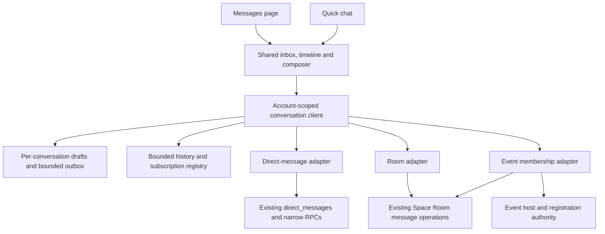

# Lightweight chat finalization plan

Updated **20 October 2026** after independent architecture, interface/performance and release/privacy reviews. Overall capability state: **Partial**. This is the current execution plan for the owner's request for a lightweight WhatsApp-like chat within Indus Orbit. The older spatial plans remain useful for their dated implementation evidence.

[This increment's verification](../../release-evidence/chat-2026-10-20/verification.md) records the two repaired regressions, 12 focused tests and the passing full member source gate with **238 units**, types, lint, formatting, builds and existing bundle limits. It does not establish the unimplemented chat phases below.

## 1. Approved outcome

The owner selected **private messages plus event/community groups** for the first release and **the current security model, with E2EE planned separately**. Files and voice notes can be added as optional modules. Familiar messaging behaviour should make the existing product easier to use while retaining Indus Orbit's identity.

First release:

- A recent-conversation inbox with preview, time, per-conversation unread count, unread filter and a separate bounded people picker.
- Reliable private text messages between accepted connections, with queued/sending/sent/read/failed feedback, retry/discard, typing preference, blocking and recovery.
- Community group text through existing Chapter/Mission Rooms and server membership rules.
- Optional event discussion for signed-in eligible attendees and hosts, with explicit event membership and revocation. Event chat must be implemented as an event capability; current Chapter/Mission membership cannot safely substitute for it.
- Shared conversation state, drafts and interaction components across the full Messages page and quick chat; mobile list/detail navigation and preserved reading position.
- Small, independently loaded capability modules where the backend already authorizes them. Current Room tools remain available in their authorized context.

Private-message eligibility continues to require an accepted connection. Public event discovery and guest registration remain available without automatically granting chat access. An email-only guest must sign in and link/verify the eligible registration before entering an event discussion. Anonymous guest chat and arbitrary standalone group creation are outside this first boundary. New group audiences must not expose Chapter/Mission history or expand those memberships.

The current security model uses encrypted connections, authenticated private channels, database permissions and server checks. It is **not end-to-end encryption**. Do not promise WhatsApp interoperability, phone-number discovery, recipient-device delivery or E2EE. An eventual E2EE design needs keys, devices, recovery, search, moderation, export and backup decisions before implementation; it is not a cosmetic toggle.

## 2. Existing foundation and current evidence

| Area                                | State and actual boundary                                                                                                                                                                                                                                                                    |
| ----------------------------------- | -------------------------------------------------------------------------------------------------------------------------------------------------------------------------------------------------------------------------------------------------------------------------------------------- |
| Direct-message history              | **Released** to the recorded demo: `public.direct_messages` is the canonical history; participant authority, accepted connections, idempotency, rate limits and symmetric blocking already exist.                                                                                            |
| History and delivery transport      | Fifty-row keyset pages, private Broadcast and typing exist. Broadcast remains an update signal; durable database rows remain authoritative. Current reconnect reconciliation is incomplete for long gaps.                                                                                    |
| Full page and quick chat            | **Partial** for this request: both use shared hooks, but each hook instance owns separate history, queue and subscription state, and the interface is duplicated.                                                                                                                            |
| Community groups                    | Existing Chapter/Mission Spaces, Rooms, Threads, moderation, reactions, mentions, search and quarantine-first attachments are substantial foundations. The simpler common chat presentation is **Planned**.                                                                                  |
| Event groups                        | **Planned**: current Space source constraints and membership projection support Chapters/Missions, not events. Guest registration is not an authenticated chat identity.                                                                                                                     |
| Current repair                      | **Verified locally**: new queued rows now appear before server acknowledgement, and an older history response no longer removes an established read receipt. Two new regression cases first failed on the previous implementation; the focused conversation suite passes 12/12 after repair. |
| Prior whole-product source evidence | The 19 October gate recorded 236 member units, 35 admin units, 49 browser journeys and a fresh 130-migration replay with 38 SQL files / 1,237 assertions. These are dated aggregate evidence, not proof of the newly requested chat experience.                                              |
| Public production                   | **Partial**. Source publication and an unchanged healthy backend do not establish genuine two-person chat, service operations or launch acceptance. See the [whole-product report](../PRODUCTION_STATUS_2026-10-20.md).                                                                      |

### Confirmed remaining defects

1. **Account transitions:** send uses the current Supabase account rather than checking the original expected sender at the mutation boundary. Late sends, contacts and attention results lack consistent account/generation guards. A→B→A can defeat a topic-only stale-result check.
2. **Competing outboxes:** page and sheet independently rewrite one account session-storage key. They can lose queued entries or replay independently. Saved entries are capped at 100 while the live queue is not; browser access to the storage getter can itself throw.
3. **Read acknowledgement:** initial history and incoming Broadcast can mark every unread row from the peer as read, even while hidden or before displaying the latest content.
4. **Reconnect holes:** fetching only the latest fifty rows cannot reconcile every message after a longer disconnection. Focus refreshes attention without reliably reconciling history.
5. **Composer identity:** one draft string per surface crosses recipients. Awaited completion can clear newer text; repeated Enter can enqueue the same submitted revision with different request IDs.
6. **Inbox and attention cost:** contacts are an unbounded connection directory without recent previews or individual unread counts. The root stream is unfiltered across RLS-visible messages and can cause exact-count request bursts.
7. **Reading continuity:** loading and incoming messages can replace/jump the timeline. Page and sheet have different failure controls. Labels, IME entry, reduced motion, mobile keyboard and focus need completion.

These are engineering work, not owner configuration tasks. Existing tests did not cover these complete interactions.

## 3. Architecture to extend

### Client and shared interface

- Extract lifecycle from `useDirectConversation.ts` into one account-scoped client/store with selector hooks. Bind every request, queue entry, draft, subscription and completion to both owner identity and a monotonic generation. Dispose private state on sign-out/change.
- One dispatcher owns queue serialization and one in-flight promise per original request ID. A durable acknowledgement reconciles and removes that pending item regardless of whether it arrives by RPC or Broadcast. Full capacity must produce a visible recovery choice; never silently lose unsent text.
- Keep same-tab queue recovery under the existing session-storage model. Access storage safely even when its getter throws. Do not silently introduce persistent plaintext history, cross-device drafts or last-seen tracking.
- Compose shared `ConversationList`, `ConversationHeader`, `ConversationTimeline`, `ConversationComposer` and `ConversationSurface` from existing primitives. Page/sheet supply layout and navigation, not separate message implementations.
- Preserve draft identity and revision when submitting. Enqueue once immediately, clear only that submitted revision, retain subsequent typing and display failed content with retry/discard.
- Maintain one subscription per distinct active conversation shared by its consumers. Give visible read ownership to one surface, with explicit activity/visibility and committed-message evidence.

### Data and authorization

- Keep direct messages in `direct_messages` and group messages in existing Room history. No replacement message database or dual writing is required.
- Add versioned narrow RPC contracts for bounded inbox summaries, paginated connection selection, expected-user sends/reads and read-through boundaries. Validate `auth.uid()` against the expected account inside the mutation, in addition to client guards. Existing clients and staged migration ordering need a written compatibility path that preserves denial.
- Return latest permitted preview/time/unread/person fields in one bounded inbox page. Avoid one history/count call per contact. Preserve privacy around blocked pairs; do not reveal who blocked the caller.
- Read-through validates that its durable boundary belongs to the selected pair. Only visibly viewing the latest content may acknowledge through that boundary, including older messages by deliberate inbox policy. A newer unseen message must remain unread.
- Reconcile reconnect/focus through the last durable known boundary in bounded resumable batches. Preserve readable content while catching up; expose incomplete recovery. A forward cursor contract or bounded backward traversal must prove there is no gap after more than fifty missed messages.
- Filter attention to recipient changes, coalesce invalidations, allow one in-flight count refresh with one queued refresh, and reject stale/account-mismatched cross-tab results. Do not add an idle polling loop.

### Event/community groups

- Present existing Chapter/Mission Rooms with the same simple conversation grammar; retain source membership, moderation and private-Thread boundaries. Group administration stays contextual.
- Add explicit event source identity, constraints and membership projection. Host/cohost authority and eligible confirmed attendee status must be checked server-side. Event membership must not grant unrelated community/Chapter/Mission access.
- Provide a verified account-to-registration claim for guests who choose to sign in. Matching an arbitrary client-supplied email is insufficient. A private invitation or guest token must not become a reusable general chat credential.
- Define optional discussion enable/disable, posting rights, cancellation/removal and post-event read-only/archive behaviour. Membership removal must deny subsequent reads/sends and future Realtime access; test previously joined channels and stale tokens.
- Keep event-group creation/provisioning idempotent. Cover approval, waitlist promotion, cancellation, declined/removed guests, duplicate registration and host changes. Public event pages must not leak group history, participant rosters or chat previews.
- Event chat is part of the requested first release, but its participant/linking implementation remains **Planned**. It must meet the same staged acceptance before being advertised as available.

### Optional features

Use typed conversation references and capability adapters: direct, Room and event-backed Room. Only render actions authorized by that server capability. Later modules may add voice notes, DM files, replies, reactions, search or push without loading them into every text conversation. Existing Room attachments/search remain scoped to Rooms. DM attachments need their own validated reservation/ownership contract; a Space reservation cannot be reused blindly.

Calls, stories/status, phone contacts, arbitrary groups, media galleries, durable cross-device drafts and E2EE are separate increments. Human messages must not ingest I/O prompts, tool/terminal output, keys or files by default; authorized links into those systems remain separate.

## 4. Indus Orbit design direction

**Intelligence, built together.** remains the brand line. The company identity and original pixel/dawn/lotus/banyan assets remain intact.

- Parchment conversation background, indigo outgoing messages, quiet neutral incoming messages and restrained saffron attention. Avoid decorative chat wallpaper and visual noise.
- Inter for dense conversation information; Fraunces for editorial headings/empty states. Reuse existing tokens rather than importing another product's typography or palette.
- Recent chats first, one clear send action, readable timestamps/date markers and contextual group controls. Offline/reconnecting states keep the last readable history on screen.
- Follow incoming messages only when the reader is near the bottom. Otherwise offer a small new-message control. Prepending history preserves the visible row and offset; reduced motion disables unnecessary scrolling animation.
- Accurate **Queued / Sending / Sent / Read / Failed** evidence. Sent means durable server acceptance. A Realtime server acknowledgement does not prove a recipient device received a message. [Supabase Broadcast documentation](https://supabase.com/docs/guides/realtime/broadcast).
- Keyboard and screen-reader labels, an appropriate message log/status announcement, IME-safe Enter, usable retry/discard targets, safe-area/mobile-keyboard handling, focus restoration and an active-peer link from sheet to full page.

## 5. Measurable lightness gates

These are **Planned acceptance targets**, not measurements achieved by the current system. Record device/browser/network profiles and full dependency-graph transfer before and after the increment.

| Area                  | Initial gate                                                                                                                                                                                                            |
| --------------------- | ----------------------------------------------------------------------------------------------------------------------------------------------------------------------------------------------------------------------- |
| Dependencies          | Reuse current primitives/backend. No new chat SDK, rich editor, icon pack or animation framework for text chat.                                                                                                         |
| Transfer              | At most 15 KiB gzip incremental text-chat code over a fresh recorded route dependency baseline. Measure page and quick chat; an individual chunk is not the full dependency graph. Explain and resolve a failed budget. |
| History/inbox         | Fifty-row pages; one coalesced initial history request per conversation and no per-contact history fan-out. Paginate people independently.                                                                              |
| Realtime              | One root attention subscription plus one shared topic per distinct active DM conversation; zero duplicate joins/fetches from page + sheet. Bound active Room subscriptions too.                                         |
| Cache/rendering       | Target 200 rendered messages and a bounded ten-conversation recent cache; retain refetchable cursors. Never evict a pending item as ordinary history. Measure before adding virtualization.                             |
| Outbox                | Hard maximum 100 queued/sending/failed items per account, enforced before enqueue; show full-queue and storage-unavailable feedback.                                                                                    |
| Typing                | At most one event per two seconds; expiry within six seconds; stop on hidden/blur/close. No stored last-seen.                                                                                                           |
| Immediate interaction | Optimistic bubble and cached conversation switch within 100 ms on the agreed test device. Record network-dependent first-load/reconnect latency separately.                                                             |
| Idle and catch-up     | No interval history/unread polling. Coalesce focus/reconnect and count invalidations; bound each catch-up batch and resume until the durable gap closes.                                                                |
| Accessibility         | No serious/critical automated findings, plus manual keyboard, IME, screen-reader, reduced-motion, 320px and 200% zoom checks.                                                                                           |

Existing per-asset 500 KiB JS/250 KiB CSS limits remain, but do not establish this lightweight boundary alone. Device-delivered receipts, globally accurate online presence and a production latency SLA are not inferred from these targets.

## 6. Ordered implementation and completion gates

| Phase                            | State                                                             | Engineering deliverable                                                                                                                                    | Exit evidence                                                                                                                                                                                               |
| -------------------------------- | ----------------------------------------------------------------- | ---------------------------------------------------------------------------------------------------------------------------------------------------------- | ----------------------------------------------------------------------------------------------------------------------------------------------------------------------------------------------------------- |
| C0: audit and safe repair        | **Verified** locally for the two merge regressions; plan complete | Record approved scope, account/event boundaries and exact defects; repair optimistic insertion and read-state regression.                                  | Regression tests fail before repair and pass after it; focused 12/12. Record full source gate separately.                                                                                                   |
| C1: identity and queue authority | **Partial**                                                       | Shared account client/dispatcher, expected-user mutation checks, generation guards, bounded safe storage, deterministic retry and per-conversation drafts. | A→B→A during every awaited operation; two surfaces; one in-flight request per ID; offline reload; uncertain commit replay; full/disabled/corrupt storage; no recipient draft crossover or late clearing.    |
| C2: inbox, receipts and recovery | **Planned**                                                       | Bounded recent-chat/people RPCs, visible read-through, recipient-filtered/coalesced attention and complete catch-up.                                       | Individual/total unread across tabs; hidden tab/closed sheet stay unread; new rows after watermark stay unread; >50-message outage has no holes/duplicates; blocked/suspended/closed/outsider SQL personas. |
| C3: shared premium interface     | **Planned**                                                       | Common components, page/sheet parity, mobile navigation, scroll anchors, failure controls, IME/labels and measured budgets.                                | Real component/browser journeys for repeated submit/new typing, history/backscroll, sheet→page draft handoff, mobile keyboard/focus/reduced motion; transfer/channel/DOM/memory evidence.                   |
| C4: community and event groups   | **Planned** for common presentation and event extension           | Reuse current Rooms; add reviewed event authority, verified registration linking, idempotent provisioning and revocation; contextual moderation.           | Member/host/attendee/waitlisted/removed/outsider tests, no Chapter-membership expansion, no public roster/history leak, revoked-channel checks, safe cancelled/archived state.                              |
| C5: privacy and release package  | **Planned** for this new increment                                | Migrations/types/compatibility plan, export/deletion/hold inventory, worker/scanner effects, updated manifests and canonical docs.                         | Fresh SQL replay if schema changes; positive/negative contracts; exact types/held boundary; member/admin affected gates, build/audit/budgets; exact release manifest and source publication.                |
| C6: hosted acceptance and launch | **Planned**                                                       | Rehearse the exact reviewed backend and frontend package in staging, then reviewed production rollout and observation.                                     | Real two-member/two-device Auth/Realtime/reconnect/read tests, operational services, old-token/revoked-channel denial, recovery and owner sign-off. Only then mark the intended environment **Released**.   |

Do not publish a broken intermediate client/RPC pairing or silently fall back to insecure browser writes. If a migration is added, update the reviewed-forward-release count and deployment manifest; the current twelve migrations/seven new functions describe the pre-chat increment only.

### Privacy and held-feature requirements

- Current export has a fixed 34-dataset allowlist. Any new persistent membership, event-chat metadata, preferences or attachment record needs explicit export/deletion/hold coverage; it is not included automatically.
- New tables created after the privacy-closure migration need explicit restrictive account-access policies. A privileged RPC must independently reject closed/suspended access; RLS alone does not secure a `SECURITY DEFINER` function.
- Retain private, content-free notifications. New previews remain authorized inbox responses, not public event payloads, analytics or email bodies by default.
- Existing attachment controls are quarantine first, 10 MB each/five per message with scanner gating. File/voice modules need MIME/size/permission/hold/physical-cleanup coverage before enabling.
- Retention is already delegated to the documented best-practice policy. Do not ask the owner to repeat that decision. Align new event-chat retention with the actual message/group inventory and preserve explicit holds; do not apply the guest-contact 90-day rule blindly to every chat record.
- The broad structured-Spaces migration is still held; its Boards, manager Room lifecycle, source-role explanation and saved-work features have 97 exact hash-bound type differences. Do not deploy it or regenerate browser types to include it silently during this increment. If event support truly depends on held code, isolate a reviewed compatible migration or present that dependency explicitly.

## 7. Whole-product completion and owner handoff

The previously verified brand, continuity, events, communication, education-safety, privacy, admin and I/O source remains dated evidence. This new approved chat scope adds engineering work before the product can be called code-complete for public launch. The [production report](../PRODUCTION_STATUS_2026-10-20.md) and [owner actions](../PRODUCTION_OWNER_ACTIONS.md) remain the whole-product baseline; this plan supplements them.

**Engineering still owns:** C1–C5 implementation and testing, the event membership/linking contract, measured performance, remaining genuine service/recovery integration, exact release ordering, documentation, authorized source publication and deployment rehearsal. A setup checklist does not make unfinished code complete.

**What the owner will need to do after the source package is ready:**

1. Provide access to a distinct safe staging environment and confirm the intended production project/domain. Current production candidate is `jpwvgpnbkrktipwhvqss`; the inactive backup is not staging. Engineering supplies the exact release package/rehearsal steps.
2. Complete Turnstile and verified Resend sender/Auth SMTP configuration through the secret stores, and choose/configure a scanner supplier. Engineering wires, tests and documents the services; keys should not be pasted into chat.
3. Enrol the real host/reviewer account with MFA, nominate a second independent root, and supply the admin hostname plus operational/support ownership.
4. Supply/approve test personas: two connected members on two devices; host/cohost, eligible signed-in event attendee, email-only guest, waitlisted/removed attendee and outsider. Participate in one short launch rehearsal covering mobile/offline, unread, revocation and recovery.
5. Complete OpenAI/DeepSeek commercial/data-processing approvals and current runtime/model activation evidence if launching paid I/O. Razorpay event tickets remain a later increment.
6. Review the production/backup/assisted-privacy operating evidence and sign off the named release after staging passes. Engineering must first show exact deployed versions and the remaining limitations.

The final code-completion report must state exact commits/trees and CI results, what was deployed where, the remaining owner actions, and any remaining engineering work. No completion percentage or launch date is supported by this audit.
